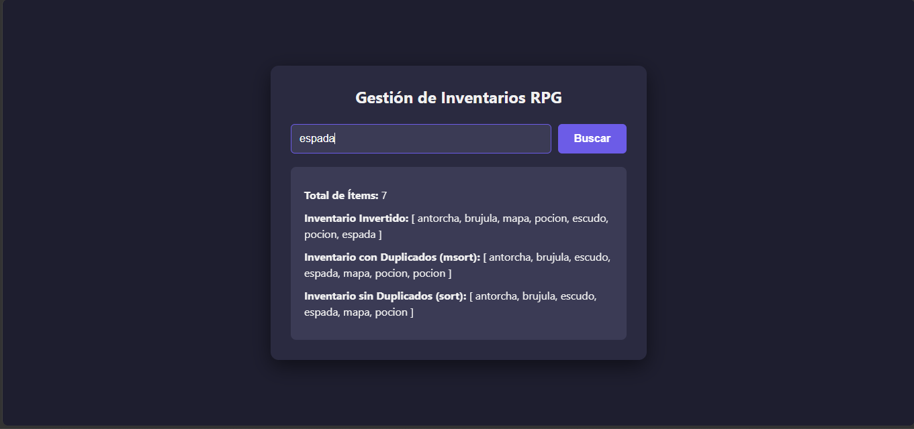
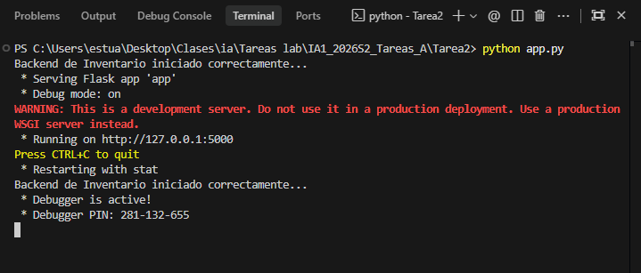

# Tarea 2 - Inteligencia Artificial 1

## Flujo del Sistema

El flujo del proyecto se divide en 3 fases integradas:

1.  **Frontend (Cliente)**: 
    *   La interfaz carga un archivo `index.html` estático en el navegador. 
    *   El usuario digita el nombre de un ítem (ej. `espada`) y le da clic a "Buscar".
    *   Se captura este evento mediante JavaScript y se utiliza la API `fetch` para enviar una petición HTTP GET de forma asíncrona hacia el Backend en la ruta: `http://localhost:5000/buscar?item=espada`.
2.  **Backend (Python + Flask)**:
    *   El servidor Flask se levanta en el puerto 5000 y expone la ruta `/buscar`.
    *   Al recibir la petición, captura el parámetro `item` del query param de la URL.
    *   Utiliza la librería `PySwip` para inyectar este parámetro directamente en una consulta a Prolog, construyendo el string: `procesar_inventario(espada, TotalItems, InventarioInvertido, InventarioUnico, InventarioOrdenado)`.
3.  **Motor de Inferencia (Prolog)**:
    *   El motor Prolog unifica las variables utilizando listas y métodos nativos.
    *   Primero extrae los hechos de los `items_principales` e `items_secundarios`, y con `append/3` crea un inventario general.
    *   Utilizando `length/2` obtiene el tamaño total.
    *   Con `member/2` valida la existencia del ítem en la lista. Si el ítem no existe, Prolog falla (retorna falso), causando que el generador de PySwip devuelva una lista vacía, lo cual es interpretado por el backend como "Ítem no encontrado" para retornar un código HTTP 404.
    *   Posteriormente usa `reverse/2`, `sort/2` y `msort/2` para obtener la lista invertida, la lista sin duplicados y la lista ordenada con duplicados respectivamente.
    *   Finalmente se hace el llamado al método recursivo `imprimir_inventario([H|T])` para que, iterativamente desestructurando la lista, imprima cada uno de los elementos en la consola del backend.
4.  **Respuesta al Cliente**:
    *   El backend recupera las variables unificadas por Prolog, convierte los átomos en strings, serializa todo en formato JSON y lo responde al cliente con un HTTP 200 OK.
    *   El frontend atrapa el JSON y mediante manipulación del DOM reemplaza dinámicamente los valores para mostrárselos al usuario final.

## Implementación Técnica

-   **Prolog**: Se utilizó el estándar de sintaxis de SWI-Prolog. El código no hardcodea ninguna respuesta en caso de encontrar el elemento (que acarrearía -40%), sino que realiza todas las operaciones lógicas de listas sobre el momento y retorna dichas variables mediante unificación. No se dejaron variables sueltas para evitar los *Singleton Variable Warnings* (-10%).
-   **Python Backend**: Se usó el microframework `Flask` por ser extremadamente ligero, ideal para una única ruta. Se importó y configuró `CORS` para habilitar las peticiones entre orígenes (evitando penalización por fallas de red CORS, -30%). La comunicación con Prolog usa `PySwip`, asegurándose que el archivo `.pl` esté en el mismo directorio.
-   **Frontend**: Creado usando Vanilla HTML, CSS y Javascript. Emplea la API `fetch` nativa moderna para realizar las llamadas asíncronas y manipular el DOM, logrando una interfaz limpia y responsiva a la interacción de los usuarios (búsqueda y errores en caso de fallar).

## Evidencia de Ejecución

### 1. Interfaz Web (Frontend con resultado JSON renderizado)

### 2. Consola del Servidor (Backend con impresión recursiva de ítems)

